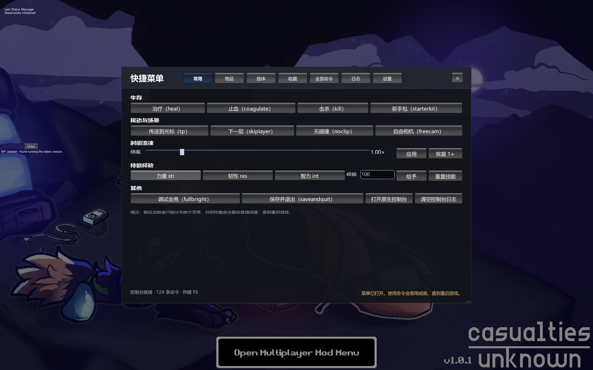
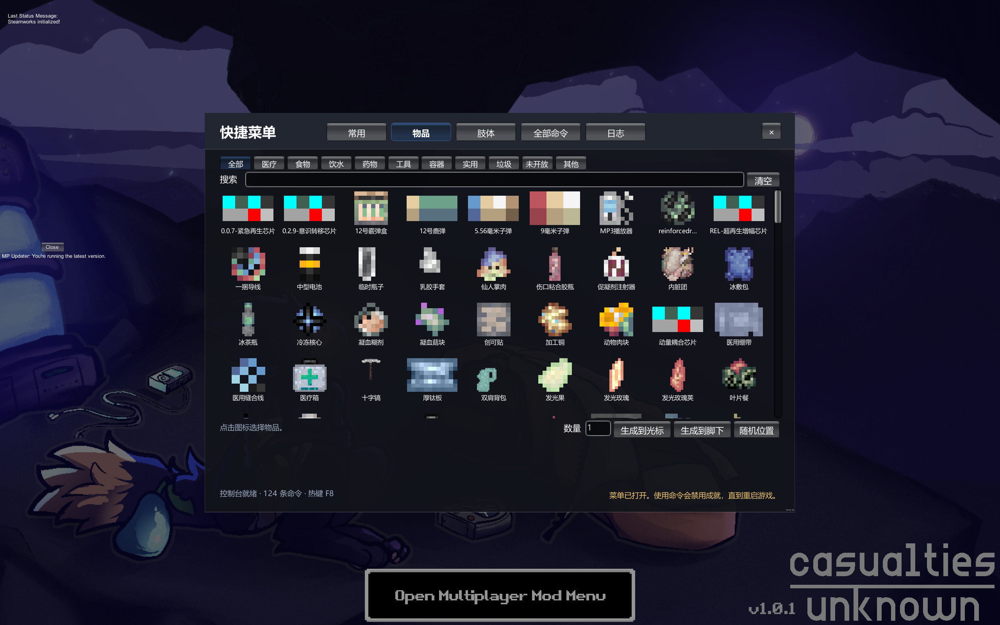
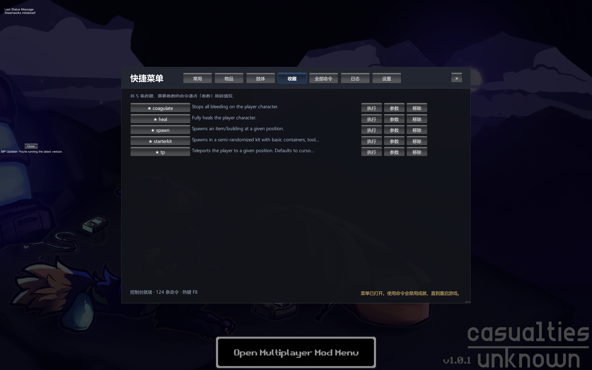
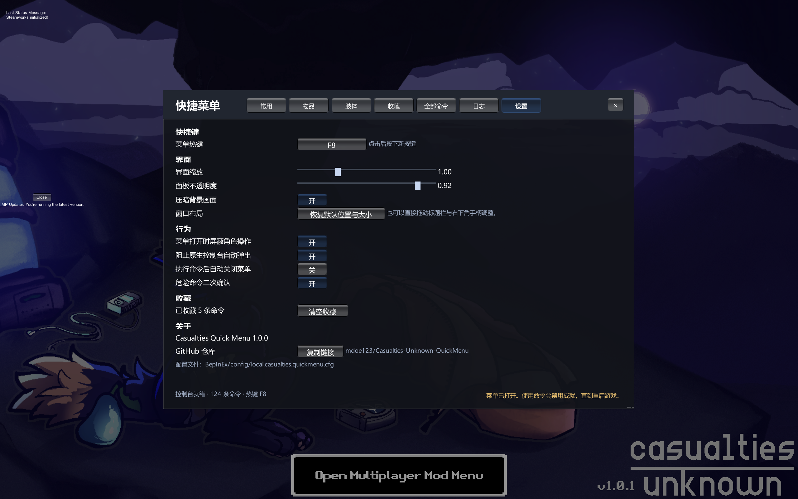

# Casualties Quick Menu

**English** | [简体中文](README.md)

An in-game quick menu for *Casualties: Unknown*. Press `F8` and the game's own developer console becomes a clickable, searchable, browsable interface.



## Why

The game already ships a full developer console (bound to `` ` `` by default) with 50 built-in commands — 124 once a multiplayer mod registers its own. The catch is that you have to type commands, remember argument order, and scroll through history.

This mod adds no gameplay features. It only reorganizes those commands into something usable.

The command list is read from `ConsoleScript.Commands` at runtime, so commands added by game updates or other mods show up automatically — no update needed on our side.

## Features

| Tab | Contents |
|---|---|
| Common | Heal, stop bleeding, kill, starter kit, teleport, next layer, noclip, freecam, timescale, skill XP, fullbright, save & quit, open native console |
| Items | Icon grid of 301 spawnable items, names follow the in-game language, with category filters and search |
| Limbs | 9 limb cards showing skin/muscle health and injuries, with per-limb stop-bleeding, amputate, reattach |
| Favorites | Saved commands on one page with one-click execution; parameterized ones jump back to the command list |
| Commands | Full command list with search, favorites pinned on top, argument autocomplete |
| Log | Console output echo — command failures show up here |
| Settings | Hotkey rebinding, UI scale and opacity, behavior toggles, clear favorites, reset window |

## Screenshots



Item icons come from each prefab's `SpriteRenderer`; names follow the game's language setting (the game ships English and Simplified Chinese).

The window can be dragged by its title bar and resized from the bottom-right grip; position and size are saved the moment you release the mouse. Panel opacity is adjustable, so the game stays visible behind it.

### Favorites

Pin the commands you use most and skip the search every time.

- Rows are sorted by name and show the command description; `Run` executes directly, `Args` jumps to the Commands tab with that command selected
- Destructive commands (kill, reset skills, save and quit) still require a second click within 3 seconds
- Favorites live in `General/Favorites` in the config file — the same set as the star in the Commands tab



### Settings

A UI for the common config entries; changes take effect immediately.

- **Hotkey**: click the button and press a key to rebind, `Esc` cancels; the menu ignores the hotkey while capturing
- **Interface**: UI scale, panel opacity, dim background, and a one-click reset for the window position and size
- **Behavior**: block character input, suppress the native console popup, close after executing, confirm destructive commands
- **Favorites**: count and a clear button
- **About**: version, repository link (copyable), config file path



## Installation

| Requirement | Version |
|---|---|
| Game | Casualties: Unknown 1.0.1 (Steam AppID 4576490) |
| Mod loader | BepInEx **5.4.23.x** (Mono x64) |
| Runtime | Unity 2022.3.62f3 |

1. Install BepInEx 5.4.23.x into the game root. This game runs on Mono — do **not** use a BepInEx 6 / IL2CPP build.
2. Drop `QuickMenu.dll` into `BepInEx/plugins/QuickMenu/`.
3. Launch the game and press `F8`.

Uninstall: delete the `BepInEx/plugins/QuickMenu/` folder. Nothing else is left behind.

## Usage

| Action | Effect |
|---|---|
| `F8` | Open / close the menu |
| `Esc` | Close the menu |
| Drag the title bar | Move the window |
| Drag the bottom-right grip (or right/bottom edge) | Resize the window |
| Tabs | Common / Items / Limbs / Favorites / Commands / Log / Settings |

While the menu is open, character input (movement, attacks, item use) is suppressed, but the game is **not paused** — the same behavior as the game's native console.

Actions on the Items and Limbs tabs are executed through the game's own commands: spawning an item is equivalent to typing `spawn <id> cursor 1 <amount>`, and stopping bleeding is `setlimbfield <limb> bleedAmount 0`.

## Configuration

Generated on first launch at `BepInEx/config/local.casualties.quickmenu.cfg`.

| Key | Default | Description |
|---|---|---|
| `General/Hotkey` | `F8` | Toggle key |
| `General/BlockGameInput` | `true` | Suppress character input while open |
| `General/SuppressNativeConsolePopup` | `true` | Stop the native console from popping up on the cheat warning |
| `General/CloseAfterExecute` | `false` | Close the menu after running a command |
| `General/ConfirmRiskyCommands` | `true` | Require a second click within 3 seconds for destructive commands |
| `General/Favorites` | empty | Favorited command names, maintained by the UI |
| `Interface/UiScale` | `1.0` | UI scale (0.6–2.0) |
| `Interface/Opacity` | `0.92` | Panel opacity (0.3–1.0) |
| `Interface/DimBackground` | `true` | Dim the screen behind the menu |
| `Interface/WindowWidth` / `WindowHeight` | `1020` / `690` | Window size in design units |
| `Interface/WindowX` / `WindowY` | `-1` / `-1` | Window position; `-1` centers it |

## Notes

- Any cheat command **disables achievements until the game restarts**. That is the game's own behavior; the mod only surfaces the warning.
- The Commands tab also lists commands registered by other mods (e.g. Together's `admin`, `ban`). Running those in singleplayer produces server-related errors, which is expected.
- Tested alongside Together 5.5.0. Both patch `PlayerCamera.HandleInput`; this mod short-circuits it with a prefix and does not conflict.
- The native console still works (backtick key). Opening the quick menu collapses it so the two input fields do not fight over the keyboard.
- BepInEx 5 (Mono) only. BepInEx 6 / IL2CPP has a different API and will not load this plugin.

## Building from source

Requires .NET SDK 6.0 or newer (build-time only).

```bash
git clone https://github.com/mdoe123/Casualties-Unknown-QuickMenu.git
cd Casualties-Unknown-QuickMenu
dotnet build -c Release
```

The target framework is `netstandard2.1` — Unity 2022.3 assemblies are compiled against .NET Standard 2.1, and 2.0 fails with `CS1705`.

The project reads game assemblies from `D:\SteamLibrary\steamapps\common\Casualties Unknown` by default. If your path differs, use either:

```bash
# Option 1: environment variable
set CASUALTIES_DIR=E:\Steam\steamapps\common\Casualties Unknown
dotnet build -c Release

# Option 2: build property
dotnet build -c Release -p:GameDir="E:\Steam\steamapps\common\Casualties Unknown"
```

The build copies the DLL to `$(GameDir)\BepInEx\plugins\QuickMenu`. If BepInEx is not present there, the deploy step is skipped and compilation still succeeds.

### Layout

```text
Casualties-Unknown-QuickMenu/
├─ src/
│  ├─ QuickMenuPlugin.cs    Entry point, config, lifecycle
│  ├─ QuickMenuUI.cs        Window chrome, drag/resize, styles
│  ├─ QuickActionsPage.cs   Common tab
│  ├─ ItemsPage.cs          Items tab
│  ├─ ItemCatalog.cs        Item catalog and icons
│  ├─ LimbsPage.cs          Limbs tab
│  ├─ FavoritesPage.cs      Favorites tab
│  ├─ FavoriteCommands.cs   Favorites store and persistence
│  ├─ CommandListPage.cs    Commands tab
│  ├─ LogPage.cs            Log tab
│  ├─ SettingsPage.cs       Settings tab
│  ├─ ConsoleBridge.cs      Single access layer to the game console
│  ├─ QuickMenuState.cs     Open/closed state
│  └─ Patches.cs            Harmony patches
├─ docs/                    Screenshots
├─ README.md / README.en.md
└─ QuickMenuMod.csproj
```

## How it works

| Area | Approach |
|---|---|
| Command list | Reads `ConsoleScript.Commands` (public static list) |
| Execution | `ConsoleScript.instance.ExecuteCommand(string)`, identical to pressing Enter in the native console |
| Input gate | Harmony prefix on `PlayerCamera.HandleInput` |
| Cheat popup | Harmony prefix on `ConsoleScript.Alert`; the message is redirected to the status bar instead |
| Console instance | Lazily calls `ConsoleScript.CheckForConsole()`; never creates a duplicate |
| UI | IMGUI with a system font, scaled from a 1080-unit design height |
| Drag / resize | Handles `Event.current` MouseDown/Drag/Up in design space; saves on release |
| Item catalog | Scans `Resources` for prefabs with an `Item` component, caches id and `Sprite`; names resolved live from `Item.GlobalItems` / `Locale` |
| Icon drawing | Converts `sprite.textureRect` to UVs and draws with `GUI.DrawTextureWithTexCoords`, so atlas sub-rects work |
| Grid performance | Row-level virtualization: only visible rows are laid out |
| Limb state | Reads public fields on `body.limbs` every frame; render-only, never mutates |
| Limb actions | Reuses `setlimbfield`, `amputate`, `reattach` with the limb's `GameObject.name` |
| Favorites | A single `FavoriteCommands` store writes through to the config; both pages share it |
| Settings tab | Binds `ConfigEntry` directly: sliders persist when the menu closes, toggles and hotkey save immediately |

All game-internal calls live in `src/ConsoleBridge.cs`, so a game update only requires changes in one file. Both patches implement `Prepare()`, which skips them gracefully when the target method disappears instead of breaking the plugin.

## Compatibility

| Item | Tested on |
|---|---|
| Game version | 1.0.1 |
| BepInEx | 5.4.23.6 + UnityDoorstop 4.6.0 |
| Engine | Unity 2022.3.62f3 / Mono x64 |
| Coexisting mod | Together 5.5.0 |

The game launched very recently, so internal APIs may still shift. This mod patches only two game methods (`PlayerCamera.HandleInput`, `ConsoleScript.Alert`); everything else goes through public fields and reflection, which keeps the breakage surface small.

## Disclaimer

For singleplayer and personal saves. Using cheat commands on a multiplayer server may violate its rules and affects other players — use your own judgment. The author is not responsible for corrupted saves or disabled achievements.

## AI Disclosure

The code and documentation in this repository were produced with AI assistance, primarily **DeepSeek-V4.1-Flash**, which handled implementation, debugging and writing. The author defined the requirements, performed the in-game verification and reviewed the final result.

Every feature was tested against the real game (see Compatibility above), but AI-generated code may still contain edge cases that were not exercised. Assess the risk before use.

## License

Licensed under the [GNU General Public License v3.0](LICENSE).
