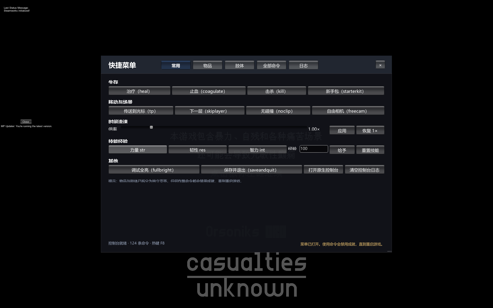
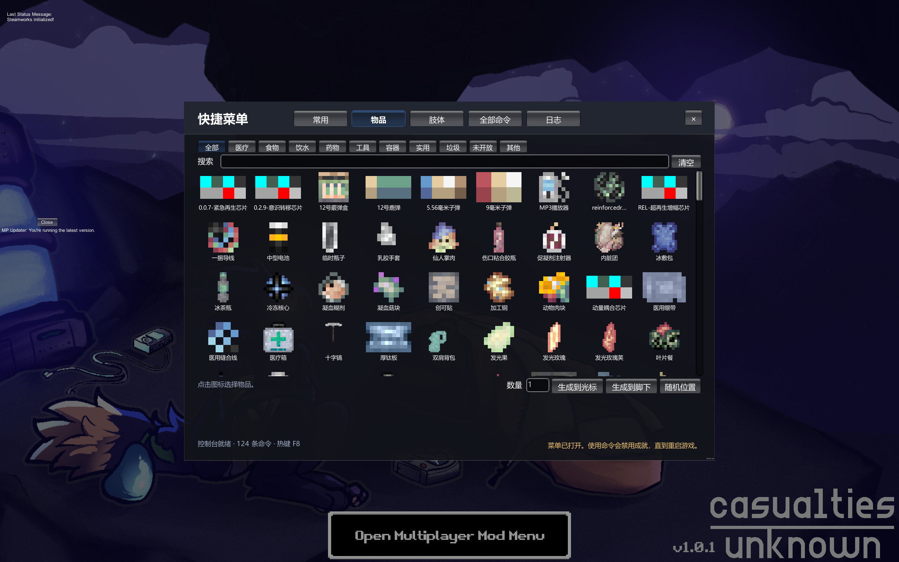

# Casualties Quick Menu

**简体中文** | [English](README.en.md)

为《Casualties: Unknown》做的游戏内快捷菜单：按 `F8` 呼出，把游戏自带的控制台命令变成可点击、可搜索、可分类浏览的界面。



## 简介

游戏本身已经内置一套完整的开发者控制台（默认反引号键 `` ` ``），基础命令 50 条，装上联机 Mod 后实测可达 124 条。问题在于它需要手打命令、记参数、翻历史记录。

这个 Mod 不新增任何游戏功能，只做一件事：把这些命令组织成能用的界面。

命令列表在运行时从 `ConsoleScript.Commands` 读取，因此游戏更新或其它 Mod 注册新命令时会自动出现，不需要等本 Mod 跟进。

## 功能

| 页签 | 内容 |
|---|---|
| 常用 | 治疗、止血、击杀、新手包、传送、下一层、无碰撞、自由相机、时间倍率、技能经验、全亮、保存退出、打开原生控制台 |
| 物品 | 301 个可生成物品的图标网格，按游戏语言显示名称，支持分类筛选与搜索 |
| 肢体 | 9 张肢体卡片，显示皮肤/肌肉健康与伤病状态，可按肢体止血、断肢、接回 |
| 全部命令 | 全部命令列表，支持搜索、收藏置顶、参数自动补全 |
| 日志 | 控制台输出回显，命令失败的原因在这里 |

## 界面



物品图标取自游戏预制体的 `SpriteRenderer`，名称跟随游戏内语言设置（内置简体中文与英文）。

窗口支持拖动标题栏移动、拖动右下角改变大小，位置与尺寸在松手时立即保存；面板不透明度可调，能透出背后的游戏画面。

## 安装

| 依赖 | 版本 |
|---|---|
| 游戏 | Casualties: Unknown 1.0.1（Steam AppID 4576490） |
| Mod 框架 | BepInEx **5.4.23.x**（Mono x64） |
| 运行时 | Unity 2022.3.62f3 |

1. 先把 BepInEx 5.4.23.x 装到游戏根目录。本作是 Mono 后端，**不要**使用 BepInEx 6 / IL2CPP 版本。
2. 把 `QuickMenu.dll` 放到 `BepInEx/plugins/QuickMenu/`。
3. 启动游戏，按 `F8`。

卸载：删除 `BepInEx/plugins/QuickMenu/` 整个目录即可，不留残留。

## 使用

| 操作 | 说明 |
|---|---|
| `F8` | 呼出 / 关闭菜单 |
| `Esc` | 关闭菜单 |
| 拖动标题栏 | 移动窗口 |
| 拖动右下角手柄（或右/下边缘） | 调整窗口大小 |
| 顶部标签 | 常用 / 物品 / 肢体 / 全部命令 / 日志 |

菜单打开时会屏蔽角色操作（移动、攻击、使用物品），但**不会暂停游戏**，这一点与游戏原生控制台一致。

物品页与肢体页的操作都通过游戏自身的命令执行：生成物品等价于输入 `spawn <id> cursor 1 <数量>`，止血等价于 `setlimbfield <肢体> bleedAmount 0`。

## 配置

路径 `BepInEx/config/local.casualties.quickmenu.cfg`，首次启动自动生成。

| 键 | 默认 | 说明 |
|---|---|---|
| `General/Hotkey` | `F8` | 呼出热键 |
| `General/BlockGameInput` | `true` | 菜单打开时屏蔽角色操作 |
| `General/SuppressNativeConsolePopup` | `true` | 阻止原生控制台被作弊警告自动弹出 |
| `General/CloseAfterExecute` | `false` | 执行命令后自动关闭菜单 |
| `General/ConfirmRiskyCommands` | `true` | 破坏性命令需 3 秒内二次确认 |
| `General/Favorites` | 空 | 收藏的命令名，由界面维护 |
| `Interface/UiScale` | `1.0` | 界面缩放（0.6–2.0） |
| `Interface/Opacity` | `0.92` | 面板不透明度（0.3–1.0） |
| `Interface/DimBackground` | `true` | 是否压暗背后画面 |
| `Interface/WindowWidth` / `WindowHeight` | `1020` / `690` | 窗口尺寸（设计单位） |
| `Interface/WindowX` / `WindowY` | `-1` / `-1` | 窗口坐标，`-1` 表示自动居中 |

## 注意事项

- 任何作弊命令都会让**成就失效，直到重启游戏**。这是游戏自身逻辑，Mod 不做干预，界面状态栏会提示。
- 「全部命令」页会包含其它 Mod 注册的命令（例如 Together 的 `admin`、`ban`），单机环境下执行会报服务器相关错误，属正常现象。
- 与 Together 5.5.0 共存已测试：两者都会修改 `PlayerCamera.HandleInput`，本 Mod 用 Prefix 短路，不冲突。
- 游戏原生控制台仍可用（反引号键）。打开快捷菜单时会把它收起，避免两个输入框抢键盘。
- 仅支持 BepInEx 5（Mono）。BepInEx 6 / IL2CPP 的 API 不同，无法直接使用。

## 从源码构建

需要 .NET SDK 6.0 或更高（仅用于编译，运行时不依赖）。

```bash
git clone https://github.com/mdoe123/Casualties-Unknown-QuickMenu.git
cd Casualties-Unknown-QuickMenu
dotnet build -c Release
```

目标框架是 `netstandard2.1`——Unity 2022.3 的托管程序集按 .NET Standard 2.1 编译，用 2.0 会报 `CS1705`。

工程默认从 `D:\SteamLibrary\steamapps\common\Casualties Unknown` 读取游戏程序集。路径不同时任选一种方式：

```bash
# 方式一：环境变量
set CASUALTIES_DIR=E:\Steam\steamapps\common\Casualties Unknown
dotnet build -c Release

# 方式二：命令行参数
dotnet build -c Release -p:GameDir="E:\Steam\steamapps\common\Casualties Unknown"
```

构建产物会自动复制到 `$(GameDir)\BepInEx\plugins\QuickMenu`。若该目录下没有 BepInEx，部署步骤会自动跳过，编译仍可成功。

### 目录结构

```text
Casualties-Unknown-QuickMenu/
├─ src/
│  ├─ QuickMenuPlugin.cs    入口、配置、生命周期
│  ├─ QuickMenuUI.cs        窗口框架、拖拽缩放、样式
│  ├─ QuickActionsPage.cs   常用页
│  ├─ ItemsPage.cs          物品页
│  ├─ ItemCatalog.cs        物品目录与图标
│  ├─ LimbsPage.cs          肢体页
│  ├─ CommandListPage.cs    全部命令页
│  ├─ LogPage.cs            日志页
│  ├─ ConsoleBridge.cs      对游戏控制台的唯一访问层
│  ├─ QuickMenuState.cs     开合状态
│  └─ Patches.cs            Harmony 补丁
├─ docs/                    截图
├─ README.md / README.en.md
└─ QuickMenuMod.csproj
```

## 实现要点

| 环节 | 做法 |
|---|---|
| 命令枚举 | 直接读 `ConsoleScript.Commands`（公开静态列表） |
| 命令执行 | `ConsoleScript.instance.ExecuteCommand(string)`，与原生控制台回车等价 |
| 输入屏蔽 | Harmony 前缀补丁 `PlayerCamera.HandleInput`，菜单打开时跳过 |
| 作弊弹窗抑制 | Harmony 前缀补丁 `ConsoleScript.Alert`，菜单打开时改投状态栏 |
| 控制台实例 | 惰性调用 `ConsoleScript.CheckForConsole()`，不会重复创建 |
| 界面 | IMGUI + 系统字体，按 1080 设计高度等比缩放 |
| 窗口拖拽 / 缩放 | 自行处理 `Event.current` 的 MouseDown/Drag/Up，坐标为设计空间，松手即写回配置 |
| 物品目录 | 扫描 `Resources` 中含 `Item` 组件的预制体，缓存 id 与 `Sprite`；名称实时向 `Item.GlobalItems` / `Locale` 查询 |
| 图标绘制 | 用 `sprite.textureRect` 换算 UV，`GUI.DrawTextureWithTexCoords` 支持图集子区域 |
| 网格性能 | 行级虚拟化，只布局可见行，避免 300 个格子每帧全量绘制 |
| 肢体状态 | 每帧读取 `body.limbs` 的 `skinHealth` / `muscleHealth` / `bleedAmount` / `broken` 等公开字段，仅渲染不修改 |
| 肢体操作 | 复用 `setlimbfield`、`amputate`、`reattach`，参数用肢体的 `GameObject.name` |

所有对游戏内部的调用集中在 `src/ConsoleBridge.cs`，游戏更新导致 API 变化时只需改这一处；两个补丁都带 `Prepare()`，目标方法缺失时自动跳过而不是让插件失效。

## 兼容性

| 项目 | 实测环境 |
|---|---|
| 游戏版本 | 1.0.1 |
| BepInEx | 5.4.23.6 + UnityDoorstop 4.6.0 |
| 引擎 | Unity 2022.3.62f3 / Mono x64 |
| 共存 Mod | Together 5.5.0 |

游戏处于发售早期，内部 API 可能随更新变化。本 Mod 对游戏方法的直接依赖只有 `PlayerCamera.HandleInput` 与 `ConsoleScript.Alert` 两处补丁，其余全部走公开字段与反射，失效风险较低。

## 免责声明

仅供单机与私人存档使用。在联机服务器上使用作弊命令可能违反服务器规则，也会影响其他玩家体验，请自行判断。使用本 Mod 造成的存档异常或成就失效，作者不承担责任。

## 许可证

本项目采用 [GNU General Public License v3.0](LICENSE) 许可。
